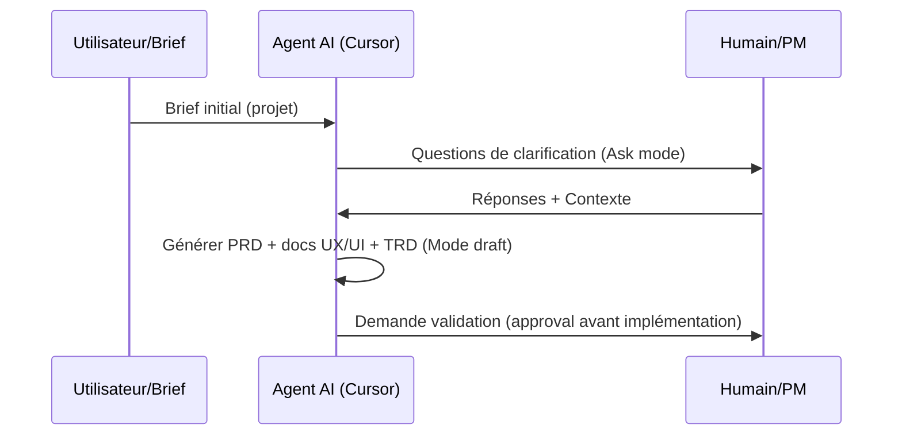

# Résumé exécutif

Ce **kit de démarrage web** est conçu pour établir une base solide, réutilisable et adaptative à chaque nouveau projet. Les choix suivants sont validés :

- **Profils de stack :** marketing (site vitrine), SaaS (appli full-stack), e-commerce (shop classique ou headless) et **complexe** (projet à multi-repos et nombreuses fonctionnalités). On ajoute **Shopify Theme** et **WordPress Theme** comme options de projet spécifiques.  
- **UI :** design *adaptive* (réactif) avec Tailwind CSS par défaut ou bibliothèque comme [shadcn/ui](https://ui.shadcn.com) selon le design system.  
- **Architecture :** *modulaire*. Frontend (Next.js) séparé du backend, avec une structure en dossiers par fonctionnalité (Atomic Design : atomes/molécules/organismes). Pages et composants page-spécifiques peuvent être préfixés par le nom de page, mais on privilégie plutôt l’utilisation de variantes de composants pour éviter la duplication.  
- **Automatisation :** le niveau *approval* signifie que Cursor doit demander une validation humaine avant chaque décision importante (par exemple choix de la stack).  

Les conventions clés incluent un nommage cohérent (fichiers **kebab-case**, composants **PascalCase**) afin de garantir la cohérence du routing et la compatibilité multiplateforme. L’arborescence respecte les conventions Next.js : fichiers spéciaux `loading.tsx`, `not-found.tsx`, `robots.tsx`, `sitemap.xml` sont prévus au besoin.  

Côté outils tiers, on prévoit par défaut : déploiement **Vercel**, base de données **Supabase** (Postgres + Auth), et gestion de projet **ClickUp**. Les CI/CD seront paramétrés avec GitHub Actions pour Vercel (via une action Vercel) et Supabase CLI. L’intégration ClickUp utilise son API et des webhooks pour créer automatiquement les tâches clés (PRD, TRD, etc.) selon des templates. La documentation Cursor inclut un `AGENTS.md` général (source de vérité) et un petit `CLAUDE.md` qui l’importe, ainsi qu’un ensemble de fichiers `.cursor/rules/*.mdc` pour cibler les règles frontend, backend, tests, sécurité, nommage, conventions Next.js, etc..  

On fournit ensuite les fichiers modèles prêts à copier : règles agent (`AGENTS.md`, `CLAUDE.md`), règles Cursor (`.cursor/rules/*.mdc`), Skills Cursor (`.cursor/skills/.../SKILL.md`), et templates markdown pour les docs du projet. Chacun inclut les sections clés (brief, PRD, UX/UI, TRD, modèle de données, contrats API, roadmap, tests, sécurité, ADR, etc.) à adapter au projet. Un diagramme Mermaid résume l’architecture modulaire (séparation frontend/backend) et le workflow de génération (Brief → Analyse Produit → Validation → Génération) ci-dessous.

```mermaid
graph LR
  subgraph Client (Next.js Frontend)
    UI[UI (Next.js + Tailwind)]
    Comp[Composants (Atom/Molécule/Organisme)]
    UI --> Comp
  end
  subgraph Serveur (Backend)
    API[API (Next.js/Edge/Routes ou Supabase Functions)]
    DB[Base de données (Supabase/Postgres)]
    Auth[Auth (Supabase Auth or OAuth)]
  end
  UI --> API
  Auth --> API
  API --> DB
```



# 1. Comparatif des **stacks** par profil

| Profil        | Choix stack Frontend    | Backend / BD             | Hébergement              | Quand choisir                                   |
|:------------- |:----------------------- |:-------------------------|:-------------------------|:-----------------------------------------------|
| **Marketing** | *Next.js* (site statique, Tailwind) ou **Jamstack** (Gatsby, Hugo) | Aucune ou Headless CMS léger (Sanity, Strapi) | Vercel (ou Netlify) pour site statique | Site vitrine ou blog, contenu peu dynamique |
| **SaaS**      | Next.js complet (App Router) + Tailwind / shadcn/ui    | Node.js/Next.js API ou Supabase (Postgres+Auth) | Vercel + Supabase Cloud  | Application web avec back-office, utilisateurs multiples |
| **Commerce**  | *Headless Shopify* (Next.js + API Shopify) ou *WooCommerce* (WordPress theme) | Shopify Store ou MySQL (WordPress) | Shopify (hébergement interne) ou hébergeur web (WP) | Boutique en ligne – si e-commerce simple, Shopify; si contenu riche ou multi-vendeur, WordPress + Woo |
| **Complexe**  | Next.js (monorepo/turborepo) + design system complet | Microservices (K8s, AWS/GCP) ou Supabase/Postgres multi-environnement | AWS/GCP + services managés, éventuellement Vercel pour front | Plateforme d’entreprise, multi-modules, évolutif |
| **Shopify Theme** | Liquid + JSON templates (Shopify CLI) | *API interne Shopify* (sans base locale) | Hébergé sur Shopify | Site marchand standard avec fonctionnalités Shopify (cart, paiement) |
| **WordPress Theme** | PHP/React Theme (WP CLI, WP REST) | MySQL (hébergement web) | Serveur PHP/MySQL (Ex: PaaS) | Blog/commerce personnalisé, besoins SEO poussé, communauté WP |

Des tableaux plus détaillés peuvent être ajoutés dans la doc, par exemple comparant les bases de données (Postgres, MySQL, SQLite), les langages (TypeScript, PHP, etc.), et les services (Vercel, Supabase, Cloud AWS/GCP). On choisit la stack en fonction du profil projet (échelle, besoins dynamiques, budget).  

# 2. Conventions et dossiers

- **Composants UI :** on suit la méthodologie *atomic design* (atomes, molécules, organismes) pour organiser les composants, ce qui favorise la réutilisation et la maintenance. Chaque composant atomique (boutons, champs, etc.) est isolé, puis combiné en molécules, etc.  
- **Nommage :** utiliser le **kebab-case** pour les fichiers et dossiers (ex. `user-profile.tsx`, `product-list.tsx`) et **PascalCase** pour les noms de composants exportés (ex. `export default function ProductList()`). Next.js est sensible au nommage : les noms de fichiers déterminent les routes et doivent être en minuscules pour éviter les incohérences multicloud. On préfixe un composant par le nom de sa page uniquement s’il est strictement spécifique à cette page (ex. `homepage_Hero.tsx`), mais on privilégie plutôt l’utilisation de **variantes** d’un même composant (props ou style) au lieu de multiplier les composants quasi identiques.  
- **Structure de répertoires :** on regroupe les fichiers par fonctionnalité ou page sous `src/`. Par exemple : `src/components/atoms/`, `src/components/molecules/`, `src/components/organisms/`, `src/app/` pour les pages routeurs Next.js, ou `src/pages/` si on utilise encore le Pages Router. Chaque page (ex. `/about`) peut vivre dans un dossier `app/about/` avec un `page.tsx`, et des sous-composants en fichiers dédiés. Les **layouts** sont gérés dans `app/layout.tsx` ou au niveau de page. Un dossier par page est utile dans les projets à nombreux écrans pour éviter un répertoire `pages` surchargé.  
- **Fichiers obligatoires Next.js :** chaque route publique en App Router nécessite au moins un `page.tsx`; on inclut généralement aussi un `loading.tsx` (affiché pendant le chargement), un `not-found.tsx` (pour les 404 locales) et les fichiers SEO : `robots.txt` et `sitemap.xml` (ou `robots.tsx`, `sitemap.tsx` générés).  
- **Front-end / Back-end distincts :** on maintient une séparation claire. Le frontend Next.js et le backend (API Next.js / Supabase) ont chacun leur propre shell/layout. On peut configurer un sous-domaine pour l’API (ex. `api.mondomaine.com`) distinct du site, pour la sécurité. Exemple d’arborescence :  
  ```
  web/           (Next.js app)
    ├── src/
    ├── public/
    ├── next.config.js
    ├── ...
  api/           (Back-end, e.g. Next.js API routes or Supabase functions)
    ├── functions/
    ├── ...
  ```
- **Performance et sécurité :** on applique des bonnes pratiques générales (lint, tests, CI). Par exemple, on limite la taille des composants (idéalement <150 lignes chacun) pour qu’ils restent lisibles. Le code asynchrone est utilisé pour les données (fetch, SWR). On évite de mettre des secrets dans le code (voir `.env.example`).  

# 3. Règles Cursor et AGENTS.md

- **AGENTS.md (format open standard)** : c’est la source de vérité générale pour tous les agents (Cursor, Copilot, Codex, etc.). Il décrit le projet, la stack, les commandes d’installation, les conventions de code (formatage, lint), comment exécuter les tests et déployer. Il doit être concis et centré sur *quoi faire* (pas *pourquoi*). Exemples de sections typiques : Vue d’ensemble du projet, installation, style de code, tests, déploiement, PR et commit. Cette approche est recommandée car AGENTS.md est reconnu par de nombreux outils AI.  
- **CLAUDE.md (pour Claude Code)** : si on utilise Claude Code, on ajoute un `CLAUDE.md` au projet qui fait simplement référence à `AGENTS.md` (par exemple `@import AGENTS.md`) ou l’inclut sommairement. Selon la documentation, Claude Code ne lit pas AGENTS.md directement; on crée donc un CLAUDE.md une-ligne pour “pointer” sur AGENTS.md.  
- **.cursor/rules/*.mdc** : Cursor utilise désormais un dossier de règles (`.cursor/rules`) avec des fichiers `.mdc` structurés (Markdown + YAML) pour les règles locales. Nous prévoyons au minimum :
  - `frontend.mdc` (règles React/Next.js, JSX, accès DOM, etc.)  
  - `backend.mdc` (Node/Supabase, architecture API)  
  - `tests.mdc` (comment écrire des tests unitaires/integration)  
  - `security.mdc` (nomenclatures des secrets, politiques RGPD)  
  - `naming.mdc` (conventions de nommage, par ex. kebab-case)  
  - `nextjs.mdc` (spécifique Next.js : pages/routes, layout, `loading.tsx` etc.).  

  Chaque `.mdc` contient un frontmatter YAML (p.ex. `glob: "**/*.tsx"` pour l’appliquer aux fichiers TSX) et une section `description:` en français avec les règles spécifiques. Par exemple, la documentation officialle suggère d’éviter les conventions mixtes et de rester cohérent. Les fichiers `.mdc` permettent de charger une règle selon le contexte (glob patterns).  

- **Skills Cursor (`.cursor/skills/`)** : on inclut des compétences réutilisables (SKILL.md) pour les workflows clés :
  - **project-bootstrap** : Initialise un nouveau projet (structure de base, dossier `PROJECT_CHARTER.md`, dossier `active/` vide).  
  - **feature-spec** : Pour spécifier une fonctionnalité précise (rédaction de spec, découpage en tâches).  
  - **implement-task** : Pour implémenter une tâche donnée (écriture du code d’après la spec).  
  - **review-before-done** : Pour exécuter la checklist de revue (code, tests, conformité aux specs).  
  - **ui-ux-review** : Pour passer en revue l’UI/UX (parcours utilisateur, accessibilité, mobile).  
  - **i-have-adhd** : Notre assistant « I Have ADHD » (output clair, actions numérotées). Ce skill doit **toujours être activé par défaut**, mais on peut le désactiver au besoin. Il impose la structure de réponse ADHD-friendly (étapes numérotées, pas de digressions).  

Chaque SKILL.md inclut un nom, une description (ici en français), les outils utilisés et le workflow. Ils sont enregistrés dans `.cursor/skills/<nom>/SKILL.md`. Lors du démarrage d’un projet, on pourra installer interactivement seulement les skills désirés (via la commande `skills add` de Cursor). Le kit prévoit un fichier listant les skills recommandés, avec instructions d’installation (ex. `npx -y skills add ... project-bootstrap`) ou documentation interne.  

# 4. CI/CD et intégrations

- **Vercel CI (GitHub Actions)** : on crée `.github/workflows/vercel.yml` pour déployer l’App Next.js à chaque push sur `main`. Par exemple, utiliser [amondnet/vercel-action](https://github.com/amondnet/vercel-action) avec les secrets `VERCEL_TOKEN`, `VERCEL_ORG_ID`, `VERCEL_PROJECT_ID`. Ce workflow clone le repo, puis exécute `vercel --prod`.  
- **Supabase CI** : on configure `.github/workflows/supabase.yml` pour déployer la DB/Edge Functions. Par exemple :
  ```yaml
  jobs:
    deploy-supabase:
      runs-on: ubuntu-latest
      steps:
        - uses: actions/checkout@v4
        - uses: supabase/setup-cli@v1
          with: { version: latest }
        - run: supabase db push --project-id ${{ secrets.SUPABASE_PROJECT_ID }}
  ```
  Cela utilise le CLI Supabase pour appliquer les migrations/schema. La docs Supabase préconise d’**utiliser le CLI avec GitHub Actions pour déployer automatiquement les functions**. On ajoutera aussi des secrets `SUPABASE_PROJECT_ID`, `SUPABASE_ACCESS_TOKEN`. Le `.env.example` contient les variables d’environnement requises : `SUPABASE_URL`, `SUPABASE_ANON_KEY`, etc.  

- **ClickUp** : on prévoit d’utiliser l’API ClickUp pour la gestion de projet. Par exemple, on peut créer un **webhook GitHub** (via Apps) qui, à la création d’un projet/issue, appelle l’API ClickUp pour générer automatiquement une liste de tâches à partir d’un template (PRD, TRD, UX...). ClickUp offre des webhooks pour réagir aux événements (via `POST /team/<id>/task`), et son API permet de créer une tâche en envoyant un POST sur `/list/{list_id}/task`. On documente dans le kit les étapes : configuration du token ClickUp, création d’un webhook vers une Lambda (ou un petit service) qui lance la création des tasks dans l’espace ClickUp. Des modèles de tâches (ClickUp Templates) sont recommandés pour standardiser les étapes (ex : “Rédiger le PRD”, “Valider le design UI”).  

# 5. Fichiers modèles

Ci-dessous les contenus de base prêt-à-copier. Adaptez-les en début de projet dans votre dépôt.

**AGENTS.md** (règles globales agent)  
```md
# Règles de projet pour agents AI

Ce projet utilise l’API Next.js et Supabase. **LANGAGES** : TypeScript, React, Node.js. **FORMATTEUR** : Prettier. **LINTER** : ESLint (Styleguidist). **Tests** : Vitest pour l’UI, Playwright pour e2e.  
**Comment démarrer** : `npm install`, puis `npm run dev` (Next.js) et `supabase start` (base de données).  
**Normes de code** : Fichiers en **kebab-case**, composants exportés en PascalCase. Respecter le design system (Tailwind / shadcn). Documenter chaque décision dans un ADR (dans `docs/architecture/`).  
**Tests** : écrire un test unitaire par composant majeur. Tests end-to-end pour les parcours critiques.  
**PR/Commit** : Utiliser des PRs pour toutes les modifications. Préfixes PR (ex. `[FRONT]`, `[BACK]`, `[UX]`). Numéroter les PR. La CI exécute lint et tests.  
**Déploiement** : Branch `main` déployée automatiquement sur Vercel. Les secrets (API keys) sont dans les **GitHub Secrets** (`VERCEL_TOKEN`, `SUPABASE_URL`, etc.). Pour rollback, rebasculer sur la release précédente.  
**Sécurité** : Ne pas commiter de secrets. Les variables sensibles vont dans `.env.local` (non versionné). Conformité RGPD à vérifier pour les données utilisateurs (consent forms).  
```

**CLAUDE.md** (bridge vers AGENTS)  
```md
@import AGENTS.md

*Note : ce fichier sert à charger les règles de base dans Claude Code (il importe AGENTS.md).*
```

**.cursor/rules/frontend.mdc** (règles Frontend)  
```mdc
---
glob: "**/*.tsx"
alwaysApply: true
---
# Règles Frontend (React/Next.js)

- Éviter les composants trop volumineux (>150 lignes) ; découper en sous-composants atomiques.  
- Respecter le routage Next.js : chaque page doit avoir un `page.tsx`. Utiliser `loading.tsx` et `not-found.tsx` pour la UX.  
- Styliser avec Tailwind (ou design system) ; pas de CSS global hors scope.  
- Pas de dépendances non vérifiées (Vérifier licence).  
```

**.cursor/rules/backend.mdc** (règles Backend)  
```mdc
---
glob: "**/api/**/*.ts"
alwaysApply: true
---
# Règles Backend (API/Supabase)

- Les requêtes complexes doivent aller sur le serveur (Next.js API Routes ou Supabase Edge Functions).  
- Valider/sanitiser toutes les entrées (`zod` ou `Joi`).  
- Implémenter l’authentification avec Supabase Auth (JWT) ou OAuth.  
- Pas de connexion DB directe dans le front-end : utiliser l’API ou un client server.  
```

**.cursor/rules/tests.mdc** (règles Tests)  
```mdc
---
alwaysApply: true
---
# Stratégie de tests

- Écrire des tests unitaires pour toute logique critique (ex. calculs, utilitaires).  
- Couvrir les parcours utilisateur principaux avec Playwright (inscription, paiement, etc.).  
- Un fichier de tests par module, nommage `*.spec.ts`.  
- Automatiser l’exécution des tests dans CI (GH Actions).  
```

**.cursor/rules/security.mdc** (règles Sécurité)  
```mdc
---
alwaysApply: true
---
# Sécurité et Confidentialité

- Ne pas logguer de données sensibles (mots de passe, tokens).  
- Utiliser HTTPS sur toutes les routes (Next.js le fait sur Vercel par défaut).  
- Suivre OWASP Top 10 pour l’API (injections, XSS, CSRF).  
- RGPD : anonymiser ou supprimer les données utilisateurs sur demande.  
```

**.cursor/rules/naming.mdc** (conventions de nommage)  
```mdc
---
alwaysApply: true
---
# Conventions de nommage

- Fichiers et dossiers : **kebab-case** (ex. `user-profile.tsx`). Exclure les majuscules dans les noms de fichier, pour cohérence de routing.  
- Composants React : **PascalCase** (`UserProfile.tsx` exportant `function UserProfile()`).  
- Variables et fonctions : camelCase.  
- Pages scoped : un composant spécifique à une page peut être prefixé (`home_Hero`), mais privilégier un seul composant `Hero` avec une prop de variante.  
```

**.cursor/skills/project-bootstrap/SKILL.md** (extrait)  
```yaml
---
name: project-bootstrap
description: |-
  Initialise un nouveau projet : crée la structure de dossier `projects/<client>__<projet>/` avec `PROJECT_CHARTER.md` et `REFERENCES.md`, et les dossiers `active/` et `archive/`. Sert à cadrer le projet (objectifs, stack, références) avant tout développement.
primary-cursor-mode: Ask
tools:
  - Read, Write, Bash
---
Agir comme un ingénieur expérimenté qui initialise un projet.
**Entrées** : bref produit du client, nom client/projet, contextes connus.
**Sorties** : `PROJECT_CHARTER.md`, `REFERENCES.md` (squelettes) dans `projects/<client>__<projet>/`.
```
*(Les autres SKILL.md suivent ce modèle avec leur description et étapes spécifiques.)*

**.cursor/skills/feature-spec/SKILL.md** (exemple d’en-tête)  
```yaml
---
name: feature-spec
description: |-
  Détailler la spécification d'une fonctionnalité du produit : identification des exigences, UX/UI envisagée, critères d'acceptation.
primary-cursor-mode: Ask
tools: Read, Write
---
Act as senior product/engineering to define feature spec...
```

**.cursor/skills/implement-task/SKILL.md**  
```yaml
---
name: implement-task
description: |-
  Implémenter le code d'une tâche à partir de sa spécification : écrire les composants/logiciels correspondants et les tests associés.
primary-cursor-mode: Agent
tools: Write, Edit
---
Act as expert developer; implement code based on feature spec...
```

**.cursor/skills/review-before-done/SKILL.md**  
```yaml
---
name: review-before-done
description: |-
  Revue de code finale avant validation : vérifier que tout correspond au PRD/UI/TRD, que les tests passent et que les conventions sont respectées.
primary-cursor-mode: Ask
tools: Read
---
Check implementation against specifications...
```

**.cursor/skills/ui-ux-review/SKILL.md**  
```yaml
---
name: ui-ux-review
description: |-
  Auditer l'interface utilisateur : parcours principal, états d'erreur, mobile, accessibilité. Donne des recommandations d'amélioration avant l'implémentation finale.
primary-cursor-mode: Agent
tools: Read, Write
---
Evaluate UI/UX flows against best practices...
```

**.cursor/skills/i-have-adhd/SKILL.md**  
```yaml
---
name: i-have-adhd
description: |-
  (Activé par défaut) Formate la réponse de l'agent pour être ADHD-friendly : action immédiate, étapes numérotées, évite les digressions.
primary-cursor-mode: Agent
tools: (n/a)
---
# Règles "I Have ADHD"
- Commencer par l'action suivante à entreprendre.
- Numéroter chaque étape importante.
- Pas de préambule inutile ni de conclusion “Bonne chance”.
- Estimer le temps en minutes si nécessaire.
- Afficher l’objectif final clairement.
```

**Templates de documentation** (dans `docs/` ou racine) :

- **PRD.md** (Product Requirements)  
```md
# Document de spécifications produit (PRD)

## Contexte
Décrivez le besoin ou le problème que le produit résout.

## Objectifs
Quelles sont les métriques ou résultats attendus (CRO, trafic, engagement, CA, etc.)?

## Utilisateurs cibles
Persona principaux / groupes d’utilisateurs.

## Fonctionnalités clés
Liste des fonctionnalités ou parcours principaux du MVP.

## Contraintes
Technologiques, légales, accès données, etc.

## Critères de succès
Comment mesurer le succès du projet (KPIs).
```

- **APP_FLOW.md** (Flux de navigation)  
```md
# Application Flow

## Parcours utilisateur
Décrire les scénarios principaux (ex.: inscription, achat, recherche).

## Arborescence des écrans
Arborescence des pages/routes de l’application (schéma ou liste).

## Interactions clés
Comportement des écrans principaux (ex.: menu, modals, carrousels, etc.).
```

- **UI_UX_SPEC.md** (Spécifications UI/UX)  
```md
# Spécifications UI/UX

## Design System
Couleurs, typographie, composants globaux.

## Wireframes / Maquettes
Décrire chaque écran (ou inclure les croquis).

## États d’erreur et responsive
Indiquer comment gérer les erreurs et le comportement sur mobile/tablette.
```

- **TRD.md** (Technical Design)  
```md
# Technical Design Document (TRD)

## Architecture générale
Description de l’architecture (monorepo/microservices, schéma global).

## Choix technologiques
Langages, frameworks, services (par ex. Next.js 14, Tailwind CSS, Supabase, etc.).

## Sécurité / Authentification
Gestion des utilisateurs, permissions, sécurité des API.

## Déploiement
Processus de build et déploiement (CI/CD, Vercel, étapes).
```

- **DATA_MODEL.md** (Modèle de données)  
```md
# Modèle de données

## Entités principales
Tableaux ou diagramme UML décrivant les principales entités et relations (par ex. Users, Orders, Products).

## Exemples
Liste des champs clés (types, contraintes).
```

- **API_CONTRACTS.md** (Contrats API)  
```md
# Contrats d'API

## Endpoints principaux
| Endpoint | Méthode | Description | Requête (exemple) | Réponse (exemple) |
|----------|---------|-------------|-------------------|-------------------|
| /api/users    | GET  | Liste des utilisateurs. | – | JSON liste d'utilisateurs. |
| /api/products | GET  | Catalogue produit.      | – | JSON liste de produits. |
| /api/login    | POST | Authentification.      | `{email, password}` | `{token, user}`. |
```

- **ADR_TEMPLATE.md** (Architecture Decision Record)  
```md
# ADR [Numéro] : *Titre de la décision*  
Date: YYYY-MM-DD

## Contexte
Description du problème ou besoin qui nécessite la décision.

## Décision
La décision prise (choix retenu).

## Alternatives considérées
Autres options et pourquoi elles ont été écartées.

## Conséquences
Impacts (positifs et négatifs) de cette décision.
```

- **ROADMAP.md** (Planification)  
```md
# Roadmap du projet

## Phases
- **Phase 1 (MVP)** : Liste des livrables prioritaires.  
- **Phase 2** : Extension UX/UI, intégrations supplémentaires.  
- **Phase 3** : Scalabilité, monitoring, optimisations.

## Tâches principales
- Démarrage : Cadrage / PRD (la présente phase).  
- UX/UI : Validation des maquettes.  
- Dev backend : Mise en place de l’API (auth, DB).  
- Dev frontend : Intégration des écrans et flux.  
- Tests & Revue : Qualité et conformité.
```

- **TEST_STRATEGY.md**  
```md
# Stratégie de tests

## Types de tests
- Tests unitaires : valider la logique métier (Vitest/Jest).  
- Tests d’intégration : vérifier l’intégration des composants (Next.js server, DB).  
- Tests end-to-end : parcours utilisateur critiques (Playwright/Cypress).  

## Outils
Vitest, Playwright, etc. Expliquer comment lancer les tests (`npm test`, `npx playwright test`).

## Critères de couverture
Objectif minimal (par ex. 80% de couverture unitaire).
```

- **SECURITY_PRIVACY.md**  
```md
# Sécurité & Confidentialité

## Authentification & Permissions
Décrire l’auth (JWT ou OAuth) et les rôles.

## RGPD & Confidentialité
Stockage des données utilisateurs, consentement, DPO.  

## Bonnes pratiques sécurité
Liste (ex : XSS, CSRF, etc. à traiter).
```

- **README.md** (Projet)  
```md
# NOM DU PROJET

Courte description.  
**Stack** : Next.js, TypeScript, Supabase, etc.  
**Démo** : (lien si disponible)  

## Installation
```
git clone ...  
npm install  
npm run dev  
```
## Structure
- `src/` : code source (pages, composants, API).  
- `docs/` : spécifications (PRD, TRD, UX, etc.).  
- `.cursor/` : règles et skills Cursor.  

## Environnement
Copier `.env.example` en `.env.local` et renseigner les variables (API keys, URL Supabase, etc.).
```

- **.env.example**  
```env
NEXT_PUBLIC_API_URL=https://api.monsite.com
NEXTAUTH_SECRET=changeme
SUPABASE_URL=https://xxxx.supabase.co
SUPABASE_ANON_KEY=PUBLIC_ANON_KEY
VERCEL_TOKEN=vercel_token
CLICKUP_TOKEN=clickup_api_token
```

- **CI - GitHub Actions (exemples)** :  
  - *vercel.yml* (déploiement) et *supabase.yml* (déploiement DB) dans `.github/workflows/`.  
  - Exemple (vercel.yml) :  
    ```yaml
    name: Deploy to Vercel
    on: [push]
    jobs:
      deploy:
        runs-on: ubuntu-latest
        steps:
          - uses: actions/checkout@v4
          - uses: amondnet/vercel-action@v20
            with:
              vercel-token: ${{ secrets.VERCEL_TOKEN }}
              vercel-org-id: ${{ secrets.VERCEL_ORG_ID }}
              vercel-project-id: ${{ secrets.VERCEL_PROJECT_ID }}
              working-directory: .
    ```
  - Exemple (supabase.yml) :  
    ```yaml
    name: Deploy Supabase
    on: [push]
    jobs:
      supabase:
        runs-on: ubuntu-latest
        steps:
          - uses: actions/checkout@v4
          - uses: supabase/setup-cli@v1
            with: { version: latest }
          - run: supabase db push --project-id ${{ secrets.SUPABASE_PROJECT_ID }}
    ```
    Ces workflows automatisent le déploiement sur Vercel et Supabase CLI (voir guide officiel).  

- **ClickUp Integration (notes)** :  
  1. Créer un espace ClickUp dédié au projet.  
  2. Définir un *template de liste de tâches* : PRD, TRD, UX/UI, Dév Front, Dév Back, Tests, Revue.  
  3. Utiliser l’API ClickUp pour créer ces tâches au début du projet (ex. via un webhook GitHub ou une action manuelle). Un appel `POST https://api.clickup.com/api/v2/list/<list_id>/task` permet de créer une tâche.  
  4. Configurer des webhooks ClickUp pour suivre l’évolution (optionnel). Le guide ClickUp explique comment s’abonner à des événements workspace.  

# 6. Conclusion

Ce kit de démarrage fournit un cadre complet pour lancer un projet web Next.js modulaire avec Cursor. Il priorise la planification **spec-driven** (PRD, UX, TRD) avant tout codage, conformément aux bonnes pratiques de développement dirigé par les spécifications. Les règles et skills sont conçus pour s’adapter aux divers profils (marketing, SaaS, commerce, complexe, Shopify, WordPress) et garantir la cohérence du code et des processus. Les diagrammes et tableaux ci-dessus, ainsi que les exemples de templates, donnent un aperçu du standard à suivre, à affiner selon le brief concret du projet. Avec cette fondation, Cursor pourra générer les documents initiaux de façon structurée, puis on validera chaque étape avant l’implémentation effective.  

**Sources :** documentation Next.js (structure de projet, routage), blog sur les conventions AGENTS.md et Cursor, article sur nommage Next.js, méthodologie Atomic Design, documentation Supabase et ClickUp pour CI/automatisation.