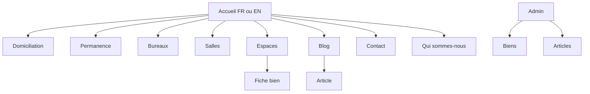
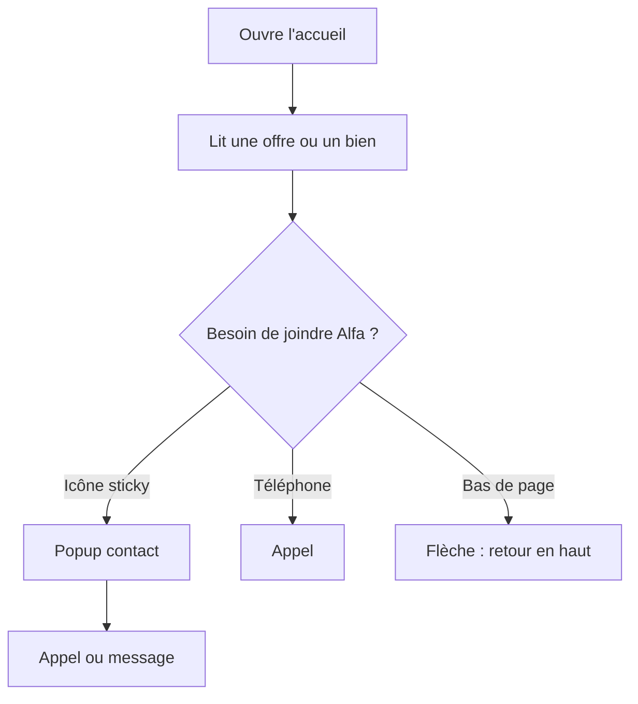

# App Flow / Information Architecture

- **Status:** DRAFT
- **Owner:** Shirley (proposition)
- **Last updated:** 2026-10-17
- **Related:** `../01-product/PRD.md`, `UI_UX_SPEC.md`

## 1. Principes d'architecture de l'information
- Utilisateur principal et tâche la plus fréquente : prospect, comprendre une offre et joindre Alfa.
- Navigation principale : Qui sommes-nous, Domiciliation commerciale, Permanence téléphonique, Location de bureaux, Salles de réunion. Lien blog à ajouter.
- Hiérarchie des contenus : barre haute, hero, quatre services, biens, services détaillés, offres, Instagram, contact, footer.
- Où l'utilisateur atterrit après connexion / ouverture : le public arrive sur l'accueil. L'éditeur arrive sur l'admin des biens.

## 2. Sitemap

## 3. Parcours critiques
Pour chaque parcours, documenter : acteur, déclencheur, préconditions, étapes, choix, erreurs, sortie réussie et critères d'abandon.

### Flow A — Prospect jusqu'au contact

### Flow B — Disponibilité d'un bien
La chargée de com ou un commercial ouvre l'admin, change la ville, l'état ou la disponibilité, enregistre. L'accueil ne montre comme libres que les biens disponibles de la ville choisie.

### Flow C — Deuxième visite
Première ouverture : pas de popup. Deuxième ouverture : trois choix visuels (réseaux, e-mail, message Instagram). Le compteur est local au navigateur. Fermer le popup l'empêche de revenir pendant cette visite. Le champ e-mail ne crée pas d'abonnement.

## 4. Inventaire des écrans / routes
| ID | Route / écran | But | Accès / rôle | Entrées | États importants | Sortie / action |
|---|---|---|---|---|---|---|
| SCR-01 | `/` et `/en` | Accueil | Public | Biens, offres, articles récents | chargement, aucun bien, erreur | Contact, filtre, services |
| SCR-02 | pages des 4 services | Détail d'offre | Public | Contenu de service | vide | Contact |
| SCR-03 | `/espaces` et fiche | Liste et détail | Public | Biens publiés | vide, indisponible | Contact |
| SCR-04 | `/blog` et article | Com et SEO | Public | Articles publiés | aucun article | Lecture |
| SCR-05 | admin biens | État et disponibilité | Éditeur | Fiche bien | erreur d'enregistrement | Liste à jour |
| SCR-06 | admin articles | Publication FR/EN | Éditeur | Brouillon | brouillon, publié | Article en ligne |

## 5. États et branches obligatoires
- Avant authentification / après authentification (si pertinent)
- Données absentes
- Données en cours de chargement
- Erreur récupérable / erreur définitive
- Permissions insuffisantes
- Action réussie et confirmation
- Retour, annulation, perte réseau et reprise

## 6. Vérification
- [ ] Chaque exigence P0 du PRD apparaît dans au moins un parcours ou est justifiée.
- [ ] Tous les écrans ont une route, un but et une condition d'accès.
- [ ] Les branches d'erreur et les états vides sont prévus.
- [ ] Les parcours restent cohérents avec permissions, modèle de données et API.
