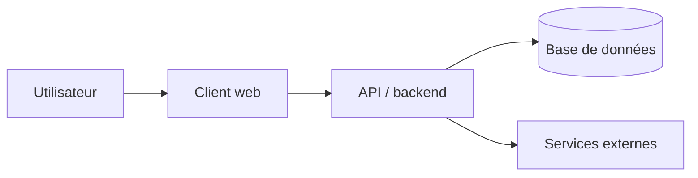

# Technical Requirements Document (TRD)

- **Status:** DRAFT
- **Owner:** Shirley (proposition)
- **Last updated:** 2026-10-17
- **Related:** PRD, UI/UX, DATA_MODEL, API_CONTRACTS, SECURITY_PRIVACY, ADRs

## 1. Objectifs techniques et contraintes
- Contraintes qui découlent du produit : site de remplacement, villes multiples, admin com et commerciaux, français et anglais, formulaire de contact, popup à la deuxième visite. Pas de paiement connu.
- Environnement de développement : dépôt sans application. Le site actuel n'est pas dans ce repo.
- Équipe / compétences / maintenance : un éditeur non développeur doit publier (Q-003).
- Budget et coûts d'exploitation : non dit.
- Exigences de disponibilité / performance : hero actuel très large (jusqu'à 1950 px). La v1 doit rester légère sur mobile.

## 2. Comparaison de stack avant décision

Le candidat de départ est Vercel + Supabase. Comparer avec les profils de `STACK_PROFILES.md` avant de le verrouiller.

| Candidat | Adéquation au produit | Coûts / limites | Compétences | Écosystème / maintenance | Risques | Verdict |
|---|---|---|---|---|---|---|
| Vercel + Supabase | Vitrine, admin, blog, FR/EN | Coûts d'hébergement non chiffrés | Admin custom à construire | Kit du dépôt | H-001 | Candidat, À VALIDER |
| Garder l'outil actuel d'alfa.fr | Déjà en production, médias et biens existants | Refonte UX peut être plus lente | Inconnu dans ce dépôt | Déjà exploité par Alfa | On reconstruit à côté du système vivant | Écarté tant que la v1 est une proposition neuve |

Ne retenir qu'une comparaison adaptée aux besoins. Vérifier la documentation officielle et les versions supportées au moment du choix.

## 3. Stack retenue (après validation)
- Frontend :
- Backend / API :
- Langage(s) :
- Base / stockage :
- Authentification / autorisation :
- Hébergement / déploiement :
- Email / paiement / recherche / analytics (si besoin) :
- Outils de build, test, qualité et monitoring :
- Raison de chaque choix :

## 4. Vue d'ensemble de l'architecture

Remplacer par l'architecture réelle, les frontières de confiance et les flux de données. Supprimer les composants non utilisés.

## 5. Responsabilités et frontières
| Composant | Responsabilités | Ne doit pas faire | Dépendances |
|---|---|---|---|
| [composant] | [responsabilités] | [limites] | [dépendances] |

## 6. Organisation du code
- Stratégie : [monolithe modulaire / autre, motivé par les besoins]
- Structure des répertoires :
- Conventions d'import et dépendances entre couches :
- Gestion des erreurs :
- Validation des entrées :
- Configuration et variables d'environnement :

## 7. Authentification, autorisation et identité
- Fournisseur / stratégie :
- Modèle de session / tokens :
- Contrôle d'accès par rôle / ressource :
- Récupération de compte / MFA si nécessaire :
- Sécurité des routes et des actions serveur :
- Politique de révocation :

## 8. Contrats et intégrations
- APIs internes : `../04-data/API_CONTRACTS.md`
- Services tiers / timeouts / retries / idempotence :
- Gestion des quotas :
- Versionnement / compatibilité :

## 9. Données, migrations et fichiers
- Source de vérité :
- Modèle : `../04-data/DATA_MODEL.md`
- Stratégie de migration et rollback :
- Transactions / intégrité :
- Stockage de fichiers, liens temporaires et contrôle d'accès :
- Sauvegarde / restauration / export :

## 10. Qualité et observabilité
- Scripts de développement, build et vérification :
- Logs, métriques, traces et alertes :
- Suivi d'erreurs :
- Sondes de santé :
- Environnements dev / preview / staging / production :
- Procédure de release et rollback :

## 11. Exigences non fonctionnelles
| Domaine | Cible mesurable | Méthode de vérification | Priorité |
|---|---|---|---|
| Performance | [seuil mesuré] | [test] | [P0/P1/P2] |
| Disponibilité | [SLO si nécessaire] | [monitoring] | [priorité] |
| Scalabilité | [volume attendu et marge] | [test] | [priorité] |
| Résilience | [comportement en panne] | [test] | [priorité] |
| Sécurité | voir SECURITY_PRIVACY.md | [contrôle] | [priorité] |

## 12. Déploiement / exploitation
- Pipeline et validations :
- Gestion des secrets :
- Séparation des environnements :
- Migrations en production :
- Sauvegarde / restauration testée :
- Coûts estimés et alertes de dépassement :
- Plan de reprise / rollback :

## 13. Décisions et risques
- ADRs : `ADR/`
- Risques techniques :
- Hypothèses à valider :
- Alternatives rejetées et raison :

## 14. Gate de validation technique
- [ ] Stack reliée aux contraintes du brief
- [ ] Architecture et responsabilités explicites
- [ ] Auth, accès, données et secrets traités
- [ ] Test / déploiement / monitoring définis au niveau nécessaire
- [ ] Schéma et contrats cohérents
- [ ] Coûts, limites et risques connus
- [ ] Décisions critiques approuvées
