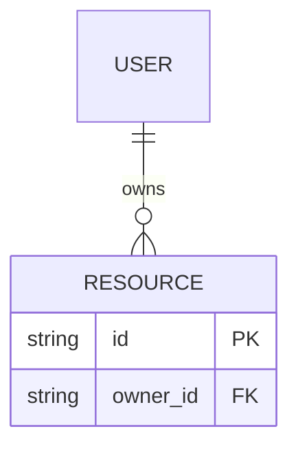

# Data Model / Backend Schema

- **Status:** DRAFT
- **Owner:** Shirley (proposition)
- **Last updated:** 2026-10-17
- **Related:** PRD, TRD, API_CONTRACTS, SECURITY_PRIVACY

> Modèle logique avant SQL ou migrations exécutables. Ne pas figer un schéma physique avant de comprendre les parcours, les droits et les règles métier.

## 1. Sources de vérité et responsabilités
- Système source pour chaque type de donnée : les biens et articles vivent dans l'admin de cette v1. Les textes d'offres partent du site actuel. Les coordonnées publiques partent d'alfa.fr.
- Données calculées vs persistées : le prix affiché est un plancher saisi, pas un calcul de devis.
- Données importées / synchronisées : Instagram non synchronisé tant que H-004 tient. Pas d'import automatique des biens tant que Q-001 est ouverte.

## 2. Entités
| Entité | Pourquoi elle existe | Propriétaire / tenant | Données principales | Durée de vie |
|---|---|---|---|---|
| Siège | Adresse de l'entreprise, pas un produit | Alfa | 177 boulevard de l'Yser, 76000 Rouen | Stable |
| Ville | Ville où des biens existent | Alfa | nom seul. Pas d'adresse en v1. | Tant que des biens y sont proposés |
| Immeuble | Bâtiment dans une ville, plus tard | Alfa | ville, adresse. Plusieurs immeubles par ville. | Prévu, pas saisi en v1 |
| Bien | Produit à louer | Alfa | nom, ville, étage, type, prix d'appel, état, disponibilité, visuel. Pas d'adresse propre en v1. | Tant que l'offre existe |
| Offre | Bloc commercial de l'accueil | Alfa | titre, puces, prix d'appel | Tant que l'offre est publiée |
| Article | Blog com et SEO | Alfa | titre, corps, langue, statut | Brouillon puis publié |
| Demande | Message du popup, si formulaire | Alfa | nom, e-mail, téléphone, message | Conservation à déterminer |

## 3. Champs par entité
### Bien
| Champ | Type logique | Obligatoire | Unique / index | Source | Validation / contrainte | Sensibilité |
|---|---|---|---|---|---|---|
| `id` | identifiant | Oui | PK | système | — | interne |
| `name` | texte | Oui | non | éditeur | nom public, ex. Bureau « Fécamp » | public |
| `floor` | texte | Non | non | éditeur | ex. 3e, 2A | public |
| `ville` | référence | Oui | index | éditeur | Ville sans adresse (D-009). Rouen peut avoir des biens et rester distincte du siège. | public |
| `kind` | enum | Oui | non | éditeur | bureau ou salle | public |
| `price_from_ht` | montant | Non | non | éditeur | euros HT, vide autorisé | public |
| `status` | enum | Oui | non | éditeur | brouillon ou publié | interne |
| `availability` | enum | Oui | non | éditeur | disponible ou indisponible | public |
| `locale` | texte | Oui | avec le slug | éditeur | `fr` ou `en` | public |

## 4. Relations et intégrité
- Relations 1:1 / 1:N / N:N :
- Suppression : cascade / restriction / anonymisation / conservation :
- Intégrité et invariants métier :
- Règles anti-doublons / idempotence :

Diagramme illustratif seulement : remplacer les entités et relations par le modèle réel.

## 5. Autorisation et isolation des données
| Ressource / entité | Anonyme | Utilisateur propriétaire | Autre utilisateur | Admin | Règles particulières |
|---|---|---|---|---|---|
| [entité] | Refus / lecture… | [droits] | [droits] | [droits] | [règle] |

- Où les contrôles sont-ils appliqués ?
- Isolation multi-tenant / RLS (si pertinente) :
- Prévention IDOR / accès direct à une ressource :

## 6. Index, requêtes et volumes
- Requêtes les plus fréquentes :
- Contraintes d'unicité :
- Index candidats et justification :
- Volumes actuels / prévus :
- Stratégie pagination / tri / recherche :

## 7. Cycle de vie et confidentialité
- Classification : publique / interne / personnelle / sensible :
- Finalité et nécessité :
- Durée de conservation :
- Export / rectification / suppression :
- Anonymisation ou agrégation :
- Champs interdits dans les logs :

## 8. Fichiers et objets (si pertinent)
- Métadonnées persistées :
- Stockage binaire :
- Limites de taille / type MIME / analyse :
- Droits, URL signées et expiration :

## 9. Migrations et exploitation
- Outil de migration :
- Compatibilité ancien/nouveau code :
- Procédure de backfill :
- Rollback / roll-forward :
- Sauvegarde et restauration :

## 10. Gate de validation
- [ ] Chaque entité correspond à un besoin métier réel
- [ ] Relations et suppressions sont explicites
- [ ] Permissions vérifiées par ressource
- [ ] Données personnelles et durée de conservation analysées
- [ ] Requêtes et index justifiés par les usages
- [ ] Migrations et stratégie de déploiement définies
